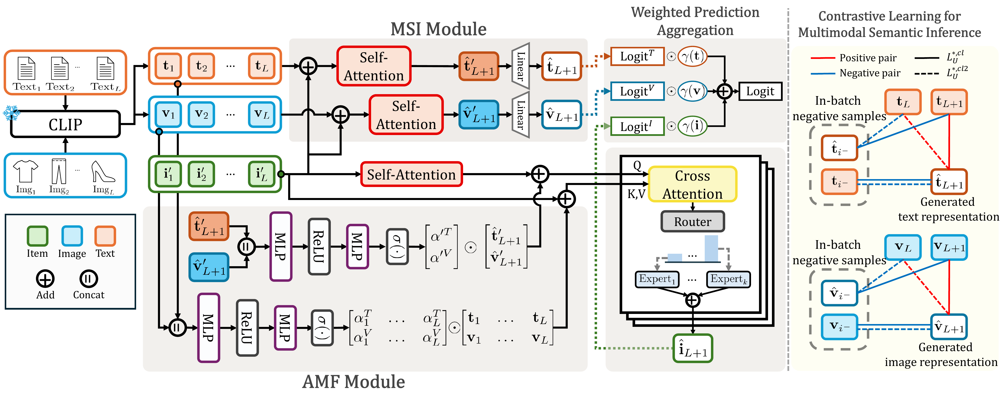

<div align="center">

<h1>[CIKM'26] Generative Multimodal Intent Modeling with Adaptive Integration for Recommendation</h1>

<strong>Official PyTorch Implementation</strong>

</div>

<p align="center">
  <a href="https://doi.org/10.0000/gemia">Paper</a> ·
  <a href="#citation">Citation</a>
</p>

<p align="center">
  
</p>

<p align="center"><em>Overview of the GEMIA architecture.</em></p>

## Quick Start

### 1. Environment

```bash
conda create -n gemia python=3.10 -y
conda activate gemia
pip install -r requirements.txt
```

### 2. Data

Preprocessed datasets are available from [Google Drive](https://drive.google.com/drive/folders/1sEMc1-q3CU4lioyvs9-SCUMPObFOFtFg?usp=sharing).

Place each dataset under `data/{data_name}/` with the following files:

```text
data/{data_name}/
├── uniqued_metadata.json
├── uniqued_test_data.pt
├── idx_img_emb_map.pt
└── idx_text_emb_map.pt
```

Use `data_amazon.ipynb` for the Amazon datasets and `data_hm.ipynb` for H&M preprocessing.

### 3. Training

Select one of `Baby`, `Clothing`, `Home`, or `HM` and run:

```bash
python main.py --config Baby
```

Experiment options are defined in `settings/*.yaml`, and outputs are saved under `model/{timestamp}/`. Running without `--config` uses `Baby` by default.

## Citation

If you find this repository useful, please cite the paper:

```bibtex
@inproceedings{gemia,
  title     = {},
  author    = {},
  booktitle = {},
  year      = {},
  doi       = {10.0000/gemia}
}
```
